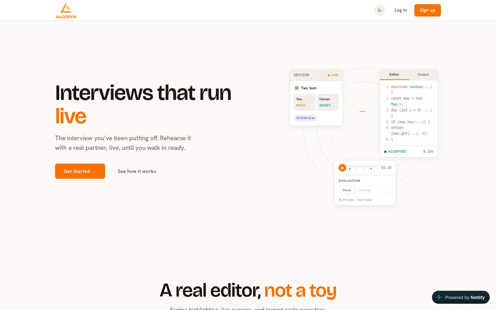
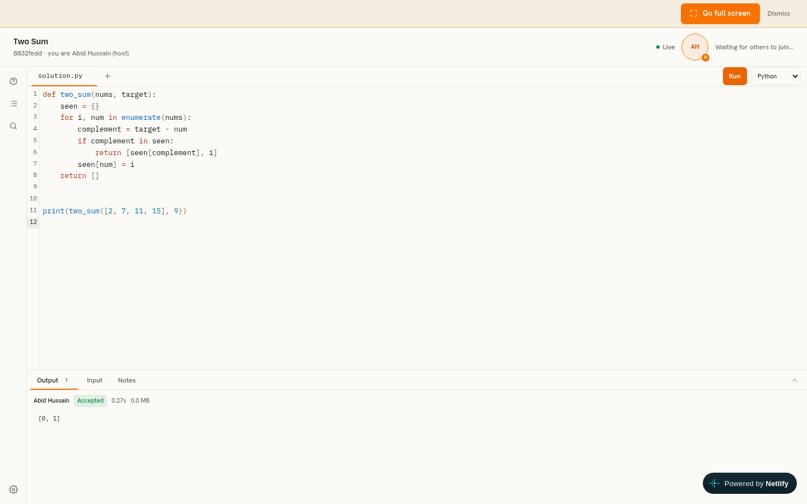
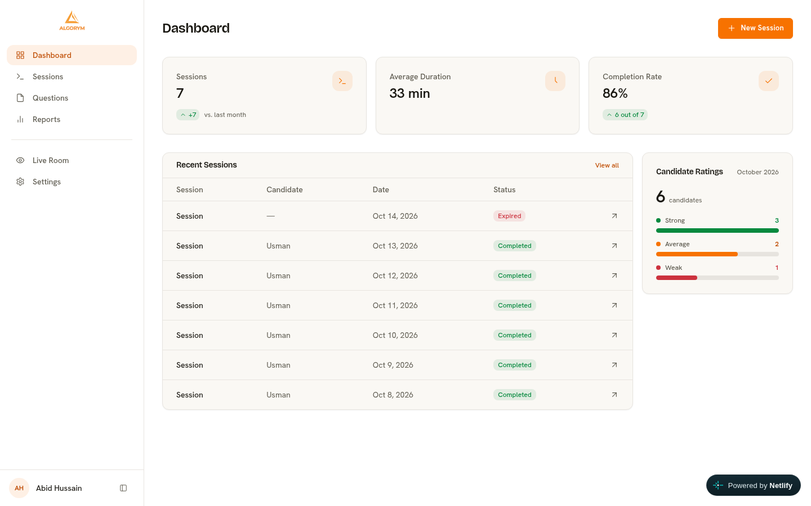
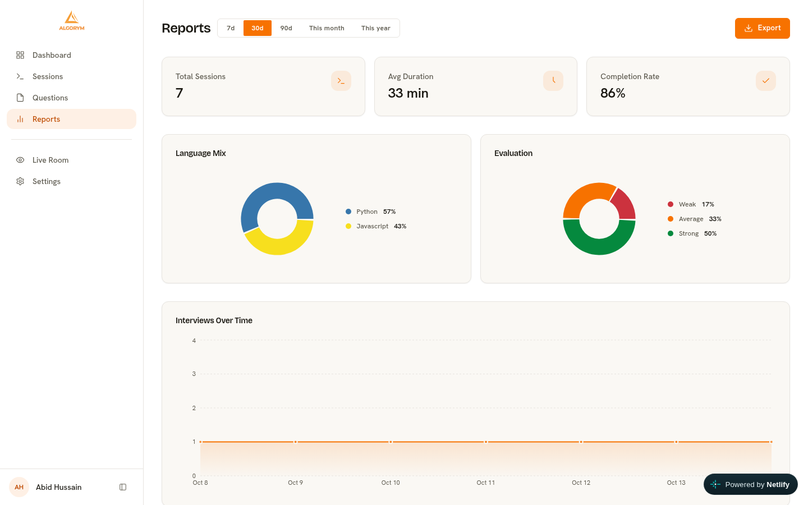

# Algorym

Algorym is a live coding interview platform. An interviewer creates a session, sends the invite link, and the candidate joins straight from the browser with no account and nothing to install. Both of you work in the same editor at the same time, run code in five languages, and watch the same verdicts appear at the same time. When the session ends the host leaves a private evaluation and everything stays replayable from the event log.

I built this to practise technical interviews with a real partner instead of talking to a whiteboard, and then kept going because the problem turned out to be genuinely fun.

## Screenshots

**Marketing site**



**Live room with a solved problem and its output**



**Dashboard**



**Reports**



## What it does

| Area | Details |
| --- | --- |
| Sessions | Interview and practice modes, tokenised invite links, scheduled sessions, start, complete and cancel with status guards |
| Editor | CodeMirror 6 with vim mode, syntax highlighting for five languages, shared files, live cursors and presence through Yjs |
| Execution | JavaScript, Python, Java, C++ and Go through a sandbox API, with stdout, stderr, compile output, time and memory for every run |
| Evaluation | Host only rating of weak, average or strong, plus private notes that never reach the guest |
| Replay | Every edit, run and question change is persisted as an event, so a session can be reviewed afterwards |
| Dashboard | Session counts, average duration, completion rate, recent sessions and a monthly rating summary |
| Reports | Range filters, sessions over time, language mix and evaluation split, with CSV export |
| Auth | Email and password with refresh rotation, revocable tokens through a token version claim, and optional Google sign in wiring |

## Tech stack

Frontend is React 19 with Vite, Tailwind CSS v4, TanStack Query, Redux Toolkit and React Router. CodeMirror 6 handles the editor and Yjs with a WebSocket provider handles the collaboration. Motion drives the animated sidebar and the marketing animations.

Backend is Express 5 in ESM on Node, with Postgres through `pg`, two WebSocket channels for events and collaboration, Zod for validation, JWT in httpOnly cookies and Resend for email.

The repo is a pnpm workspace with three packages:

```
apps/client     React app
apps/server     Express API and WebSocket server
packages/shared-types   types shared by both
```

## Running it locally

You need Node 22, pnpm and a Postgres database.

```bash
pnpm install
cp apps/server/.env.example apps/server/.env
pnpm db:setup
pnpm dev
```

The client runs on 5173 and the API on 3000. The API base URL comes from `VITE_API_URL` in `apps/client/.env`, and without it the client talks to `localhost:3000` in development.

## Environment

| Variable | Used by | Purpose |
| --- | --- | --- |
| `DATABASE_URL` | server | Postgres connection string |
| `JWT_SECRET` | server | Signing key for access and refresh tokens |
| `CLIENT_URL` | server | Allowed CORS origin |
| `CODE_RUN_API_KEY` | server | Key for the code execution sandbox |
| `RESEND_API_KEY` | server | Transactional email |
| `GEMINI_API_KEY` | server | Optional question description generation |
| `VITE_API_URL` | client | API base URL used by the browser |

## Tests

```bash
pnpm --filter server test
```

The server suite runs against a real Postgres database, which it rebuilds from `apps/server/src/db/schema.sql` on every run. It covers auth and token revocation, session lifecycle and joining, the run endpoint, evaluation ownership, and the events feed.

## Deployment

The client builds to static files and deploys to Netlify. The server deploys to Render with a managed Postgres instance. A scheduled GitHub Actions workflow pings the health endpoint so the free tier instance does not sleep during the day.

## Licence

ISC